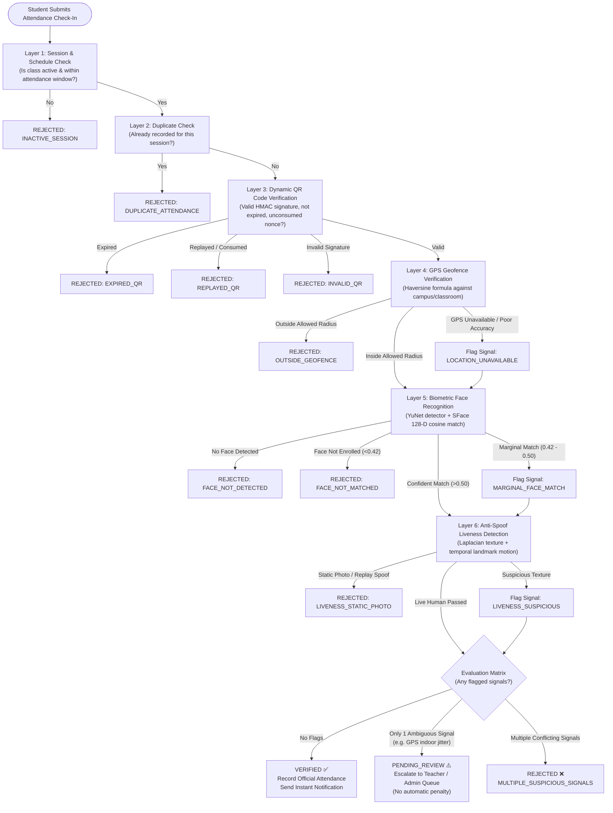

# SmartAttend AI — Multi-Layer Attendance Verification Flow

---

## Verification Layers Overview

### 1. Active Session & Window Validation
- Verifies that the attendance request corresponds to a lecture or teacher session currently marked `ACTIVE` or `Open`.
- Enforces scheduled attendance windows (e.g. 5 minutes before to 15 minutes after class start).

### 2. Duplicate Prevention
- Checks both the lecture ledger and daily attendance records to block double-punching.

### 3. Dynamic Rotating QR Code
- Teacher projects a dynamic rotating QR token in class.
- Token expires after a configurable interval (default: 30 seconds).
- Signed server-side using HMAC-SHA256 with a unique cryptographic nonce.
- Nonces are consumed once in the database; screenshots taken by absent students expire before they can be forwarded and used.

### 4. Device GPS Geofencing (Haversine Formula)
$$\text{haversine}(\theta) = \sin^2\left(\frac{\Delta \text{lat}}{2}\right) + \cos(\text{lat}_1)\cos(\text{lat}_2)\sin^2\left(\frac{\Delta \text{lon}}{2}\right)$$
$$d = 2 R \cdot \arcsin\left(\sqrt{\text{haversine}(\theta)}\right)$$
- Measures the physical distance between the student's mobile/laptop device and the classroom center.
- Handles edge cases: poor indoor satellite accuracy or denied location permissions do not automatically fail the student; they are escalated to manual review.

### 5. Face Recognition & Embedding Similarity
- OpenCV YuNet detector extracts 5-point facial landmarks.
- OpenCV SFace extracts a 128-dimensional embedding vector normalized on the unit hypersphere.
- Cosine similarity matching:
  - $\ge 0.50$: Verified identity match.
  - $0.42 - 0.50$: Borderline match (queued for review).
  - $< 0.42$: Rejected as unrecognized face.

### 6. Anti-Spoof Liveness Analysis
- **Texture Analysis:** Computes Laplacian variance across the bounding box region to detect blur or pixel grid patterns characteristic of mobile screens or printed paper.
- **Temporal Motion Tracking:** Tracks facial landmarks across successive frames to detect natural micro-motions and eye blinks, rejecting static 2D masks and printed paper.

### 7. Decision Matrix: Defense-in-Depth
- **VERIFIED:** All required layers passed convincingly. Official attendance recorded immediately.
- **REJECTED:** Definitive spoofing, invalid credentials, replayed QR token, or outside boundary.
- **PENDING_REVIEW:** Ambiguous or noisy sensor data (e.g. slight GPS indoor drift) is queued for faculty confirmation so legitimate students are never unfairly penalized.
