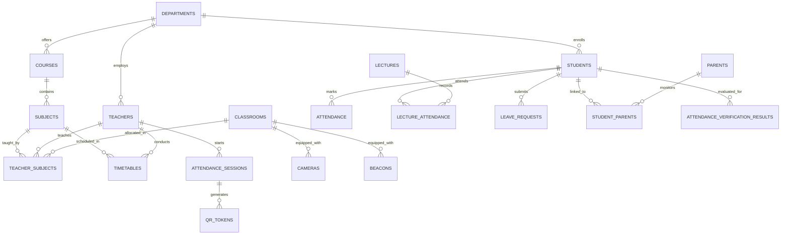

# SmartAttend AI — Database Schema Documentation

**Database Engine:** SQLite 3 (Production Compatible with PostgreSQL via SQLAlchemy / Django ORM if migrated)  
**Encoding:** UTF-8  
**Foreign Keys:** Enforced (`PRAGMA foreign_keys = ON`)  
**Biometric Storage:** Normalized 128-D `np.float32` BLOBs (Binary Large Objects)  

---

## Entity Relationship Overview

---

## 1. Master Academic Entities

### `departments`
Stores academic departments.
- `id` (INTEGER PRIMARY KEY AUTOINCREMENT)
- `name` (TEXT UNIQUE NOT NULL)
- `code` (TEXT UNIQUE NOT NULL)
- `head_teacher_id` (INTEGER NULL)
- `created_at` (TIMESTAMP DEFAULT CURRENT_TIMESTAMP)

### `courses`
Academic degree programs (e.g. B.Tech Computer Science).
- `id` (INTEGER PRIMARY KEY AUTOINCREMENT)
- `department_id` (INTEGER NOT NULL, FK -> `departments(id)`)
- `name` (TEXT NOT NULL)
- `code` (TEXT UNIQUE NOT NULL)
- `semester` (INTEGER NOT NULL DEFAULT 1)
- `academic_year` (TEXT DEFAULT '2026-27')
- `credits` (INTEGER DEFAULT 4)
- `created_at` (TIMESTAMP DEFAULT CURRENT_TIMESTAMP)

### `subjects`
Course subjects / modules.
- `id` (INTEGER PRIMARY KEY AUTOINCREMENT)
- `course_id` (INTEGER NOT NULL, FK -> `courses(id)`)
- `name` (TEXT NOT NULL)
- `code` (TEXT UNIQUE NOT NULL)
- `type` (TEXT CHECK(type IN ('Theory', 'Practical', 'Tutorial')))
- `created_at` (TIMESTAMP DEFAULT CURRENT_TIMESTAMP)

### `classrooms`
Physical physical facilities and lecture halls.
- `id` (INTEGER PRIMARY KEY AUTOINCREMENT)
- `name` (TEXT NOT NULL)
- `building` (TEXT)
- `floor` (INTEGER DEFAULT 0)
- `capacity` (INTEGER DEFAULT 60)
- `campus_id` (INTEGER FK -> `campuses(id)`)
- `latitude` (REAL NULL)
- `longitude` (REAL NULL)
- `is_active` (INTEGER DEFAULT 1)
- `created_at` (TIMESTAMP DEFAULT CURRENT_TIMESTAMP)

---

## 2. User & Authentication Entities

### `students`
Registered students with enrolled facial embeddings.
- `id` (INTEGER PRIMARY KEY AUTOINCREMENT)
- `roll_no` (TEXT UNIQUE NOT NULL)
- `name` (TEXT NOT NULL)
- `department` (TEXT DEFAULT 'General')
- `email` (TEXT DEFAULT '')
- `embedding` (BLOB NOT NULL) — 128-D `np.float32` vector
- `created_at` (TIMESTAMP DEFAULT CURRENT_TIMESTAMP)

### `student_logins`
Credentials for the student portal.
- `id` (INTEGER PRIMARY KEY AUTOINCREMENT)
- `student_id` (INTEGER UNIQUE NOT NULL, FK -> `students(id)`)
- `password_hash` (TEXT NOT NULL)
- `salt` (TEXT NOT NULL)
- `last_login` (TIMESTAMP)
- `is_active` (INTEGER DEFAULT 1)

### `teachers`
Faculty accounts for attendance session management.
- `id` (INTEGER PRIMARY KEY AUTOINCREMENT)
- `employee_id` (TEXT UNIQUE NOT NULL)
- `name` (TEXT NOT NULL)
- `email` (TEXT UNIQUE NOT NULL)
- `department_id` (INTEGER FK -> `departments(id)`)
- `password_hash` (TEXT NOT NULL)
- `salt` (TEXT NOT NULL)
- `is_active` (INTEGER DEFAULT 1)
- `created_at` (TIMESTAMP DEFAULT CURRENT_TIMESTAMP)

### `parents`
Parent / guardian accounts.
- `id` (INTEGER PRIMARY KEY AUTOINCREMENT)
- `name` (TEXT NOT NULL)
- `email` (TEXT UNIQUE NOT NULL)
- `phone` (TEXT)
- `password_hash` (TEXT NOT NULL)
- `salt` (TEXT NOT NULL)
- `created_at` (TIMESTAMP DEFAULT CURRENT_TIMESTAMP)

### `student_parents`
Many-to-many relationship linking parents to their wards.
- `student_id` (INTEGER, FK -> `students(id)`)
- `parent_id` (INTEGER, FK -> `parents(id)`)
- `relation` (TEXT DEFAULT 'Parent')
- PRIMARY KEY (`student_id`, `parent_id`)

### `admins`
System administrator accounts.
- `id` (INTEGER PRIMARY KEY AUTOINCREMENT)
- `username` (TEXT UNIQUE NOT NULL)
- `password_hash` (TEXT NOT NULL)
- `salt` (TEXT NOT NULL)
- `created_at` (TIMESTAMP DEFAULT CURRENT_TIMESTAMP)

---

## 3. Attendance & Verification Entities

### `attendance`
Daily presence ledger (backward-compatible).
- `id` (INTEGER PRIMARY KEY AUTOINCREMENT)
- `student_id` (INTEGER NOT NULL, FK -> `students(id)`)
- `date` (TEXT NOT NULL)
- `time` (TEXT NOT NULL)
- `status` (TEXT NOT NULL CHECK(status IN ('PRESENT', 'LATE')))
- `confidence` (REAL NOT NULL)
- `created_at` (TIMESTAMP DEFAULT CURRENT_TIMESTAMP)

### `lectures`
Scheduled course lectures.
- `id` (INTEGER PRIMARY KEY AUTOINCREMENT)
- `course_code` (TEXT NOT NULL)
- `subject_name` (TEXT NOT NULL)
- `section` (TEXT DEFAULT 'A')
- `instructor_name` (TEXT NOT NULL)
- `date` (TEXT NOT NULL)
- `start_time` (TEXT NOT NULL)
- `end_time` (TEXT NOT NULL)
- `duration_minutes` (INTEGER DEFAULT 50)
- `room` (TEXT DEFAULT 'Room 101')
- `status` (TEXT CHECK(status IN ('Scheduled', 'Open', 'Closed', 'Cancelled')))

### `lecture_attendance`
Per-lecture attendance records with mid-lecture checks and distances.
- `id` (INTEGER PRIMARY KEY AUTOINCREMENT)
- `lecture_id` (INTEGER NOT NULL, FK -> `lectures(id)`)
- `student_id` (INTEGER NOT NULL, FK -> `students(id)`)
- `date` (TEXT NOT NULL)
- `marked_at` (TEXT NOT NULL)
- `status` (TEXT CHECK(status IN ('PRESENT', 'LATE', 'ABSENT')))
- `confidence` (REAL NOT NULL)
- `initial_verified` (INTEGER DEFAULT 1)
- `mid_lecture_verified` (INTEGER NULL)
- `distance_meters` (REAL NULL)
- UNIQUE(`lecture_id`, `student_id`)

### `attendance_sessions`
Teacher-initiated live sessions with dynamic QR and geofence enforcement.
- `id` (INTEGER PRIMARY KEY AUTOINCREMENT)
- `teacher_id` (INTEGER NOT NULL)
- `subject_id` (INTEGER FK -> `subjects(id)`)
- `classroom_id` (INTEGER FK -> `classrooms(id)`)
- `lecture_id` (INTEGER FK -> `lectures(id)`)
- `session_date` (TEXT NOT NULL)
- `status` (TEXT CHECK(status IN ('ACTIVE', 'ENDED', 'CANCELLED')))
- `qr_expiry_seconds` (INTEGER DEFAULT 30)
- `require_face` (INTEGER DEFAULT 1)
- `require_location` (INTEGER DEFAULT 1)
- `require_qr` (INTEGER DEFAULT 1)

### `qr_tokens`
Time-bound, one-time rotating attendance tokens.
- `id` (INTEGER PRIMARY KEY AUTOINCREMENT)
- `nonce` (TEXT UNIQUE NOT NULL)
- `session_id` (INTEGER NOT NULL)
- `classroom_id` (INTEGER)
- `teacher_id` (INTEGER NOT NULL)
- `issued_at` (TIMESTAMP NOT NULL)
- `expires_at` (TIMESTAMP NOT NULL)
- `consumed` (INTEGER DEFAULT 0)
- `consumed_by_student_id` (INTEGER NULL)
- `consumed_at` (TIMESTAMP NULL)

### `attendance_verification_results`
Multi-layer verification audit records (recording borderline events for review).
- `id` (INTEGER PRIMARY KEY AUTOINCREMENT)
- `session_id` (INTEGER NULL)
- `lecture_id` (INTEGER NULL)
- `student_id` (INTEGER NOT NULL, FK -> `students(id)`)
- `overall_status` (TEXT CHECK(overall_status IN ('VERIFIED', 'REJECTED', 'PENDING_REVIEW')))
- `face_match_score` (REAL)
- `face_status` (TEXT)
- `liveness_status` (TEXT)
- `liveness_texture_score` (REAL)
- `location_status` (TEXT)
- `location_distance_m` (REAL)
- `qr_status` (TEXT)
- `rejection_reason` (TEXT)
- `submitted_at` (TIMESTAMP DEFAULT CURRENT_TIMESTAMP)
- `reviewed_by` (TEXT NULL)
- `reviewed_at` (TIMESTAMP NULL)

---

## 4. Institutional Operations & Security Entities

### `leave_requests`
Official, medical, and personal student leave applications.
- `id` (INTEGER PRIMARY KEY AUTOINCREMENT)
- `student_id` (INTEGER NOT NULL, FK -> `students(id)`)
- `leave_type` (TEXT CHECK(leave_type IN ('MEDICAL', 'PERSONAL', 'OFFICIAL', 'BEREAVEMENT', 'OTHER')))
- `from_date` (TEXT NOT NULL)
- `to_date` (TEXT NOT NULL)
- `reason` (TEXT NOT NULL)
- `supporting_document_path` (TEXT NULL)
- `status` (TEXT CHECK(status IN ('PENDING', 'APPROVED', 'REJECTED', 'CANCELLED')))
- `reviewed_by` (TEXT NULL)
- `reviewed_at` (TIMESTAMP NULL)
- `review_comment` (TEXT NULL)

### `notifications`
Transactional alerts and warning communications.
- `id` (INTEGER PRIMARY KEY AUTOINCREMENT)
- `recipient_type` (TEXT CHECK(recipient_type IN ('STUDENT', 'TEACHER', 'PARENT', 'ADMIN')))
- `recipient_id` (INTEGER NOT NULL)
- `recipient_email` (TEXT)
- `type` (TEXT NOT NULL)
- `subject` (TEXT NOT NULL)
- `body` (TEXT NOT NULL)
- `is_sent` (INTEGER DEFAULT 0)
- `sent_at` (TIMESTAMP NULL)
- `error_message` (TEXT NULL)

### `cameras`
Registered fixed classroom cameras.
- `id` (INTEGER PRIMARY KEY AUTOINCREMENT)
- `camera_uid` (TEXT UNIQUE NOT NULL)
- `name` (TEXT NOT NULL)
- `classroom_id` (INTEGER FK -> `classrooms(id)`)
- `campus_id` (INTEGER FK -> `campuses(id)`)
- `api_key_hash` (TEXT NOT NULL)
- `api_key_salt` (TEXT NOT NULL)
- `is_active` (INTEGER DEFAULT 1)
- `health_status` (TEXT DEFAULT 'UNKNOWN')

### `beacons`
Registered Bluetooth Low Energy proximity beacons.
- `id` (INTEGER PRIMARY KEY AUTOINCREMENT)
- `beacon_uuid` (TEXT UNIQUE NOT NULL)
- `major` (INTEGER)
- `minor` (INTEGER)
- `name` (TEXT NOT NULL)
- `classroom_id` (INTEGER FK -> `classrooms(id)`)
- `is_active` (INTEGER DEFAULT 1)

### `timetables`
Weekly scheduled periods.
- `id` (INTEGER PRIMARY KEY AUTOINCREMENT)
- `subject_id` (INTEGER NOT NULL, FK -> `subjects(id)`)
- `teacher_id` (INTEGER NOT NULL, FK -> `teachers(id)`)
- `classroom_id` (INTEGER FK -> `classrooms(id)`)
- `day_of_week` (INTEGER CHECK(day_of_week BETWEEN 0 AND 6))
- `start_time` (TEXT NOT NULL)
- `end_time` (TEXT NOT NULL)
- `is_active` (INTEGER DEFAULT 1)

### `holidays`
Institutional and national calendar holidays.
- `id` (INTEGER PRIMARY KEY AUTOINCREMENT)
- `date` (TEXT UNIQUE NOT NULL)
- `name` (TEXT NOT NULL)
- `type` (TEXT DEFAULT 'NATIONAL')
- `is_active` (INTEGER DEFAULT 1)

### `audit_logs`
System security and administrative audit trail.
- `id` (INTEGER PRIMARY KEY AUTOINCREMENT)
- `action` (TEXT NOT NULL)
- `details` (TEXT NOT NULL)
- `actor` (TEXT DEFAULT 'SYSTEM')
- `ip_address` (TEXT DEFAULT '127.0.0.1')
- `timestamp` (TIMESTAMP DEFAULT CURRENT_TIMESTAMP)
